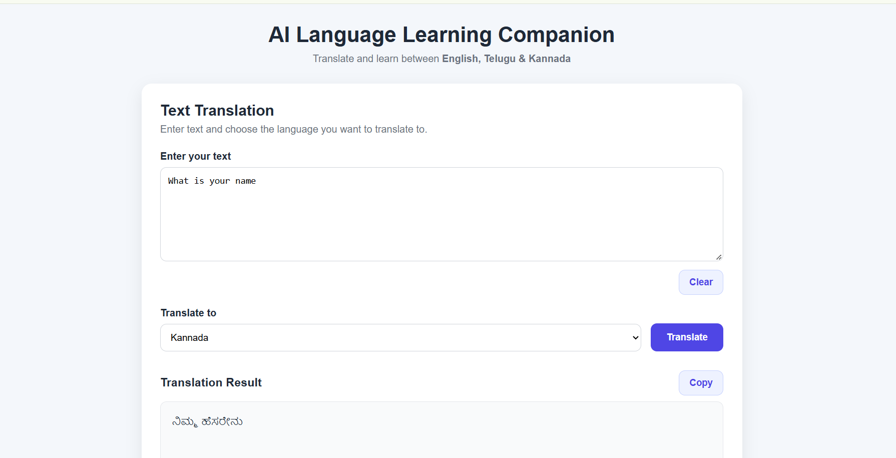
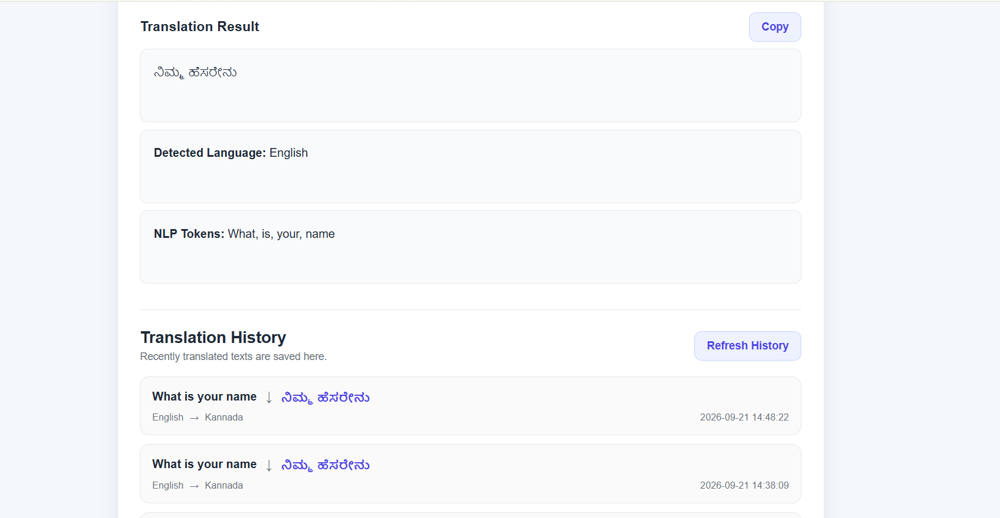
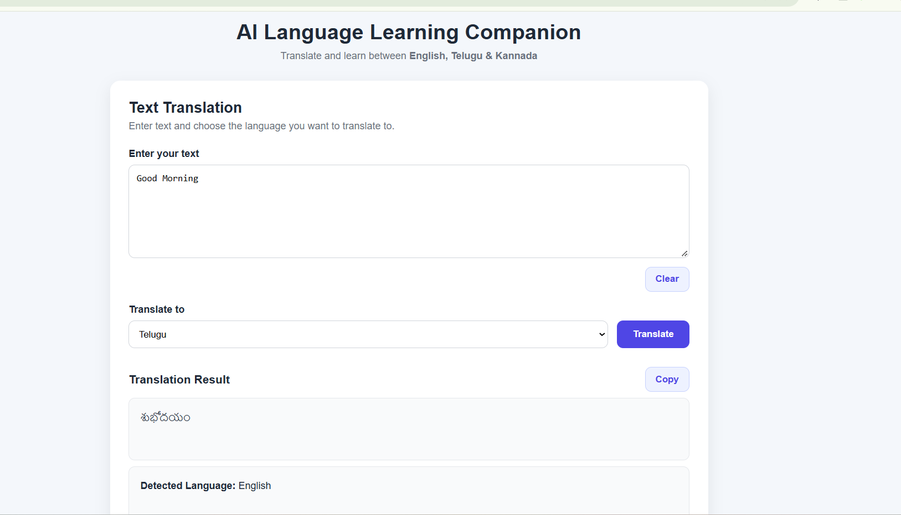
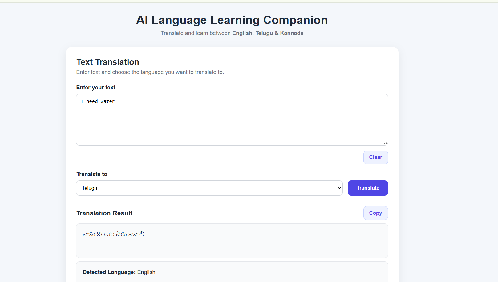
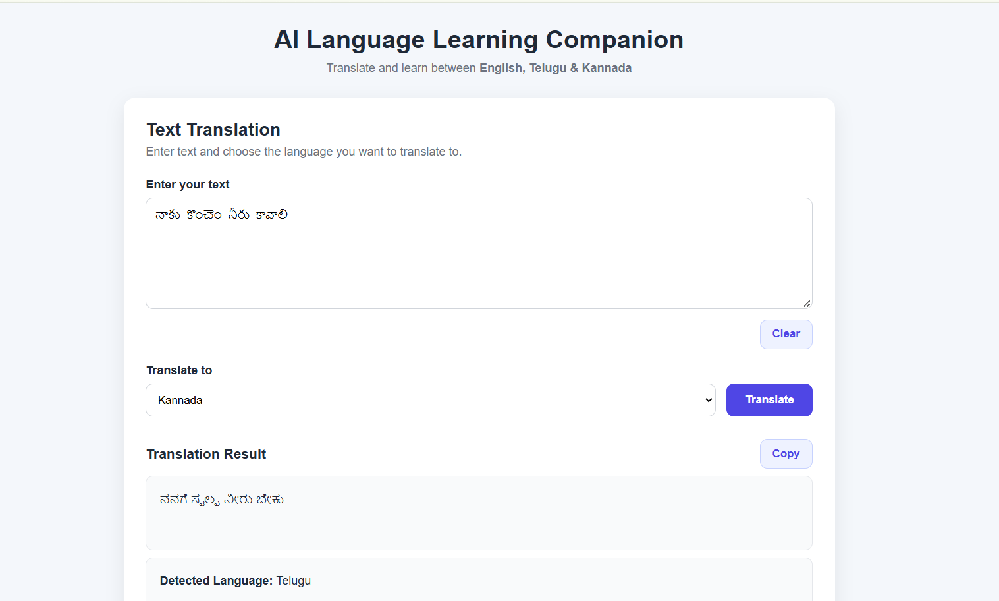
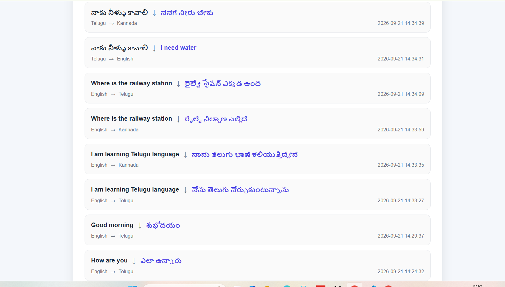
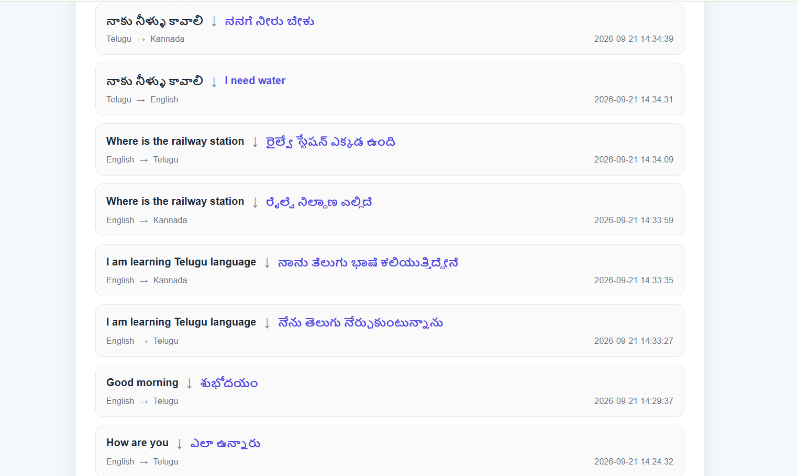
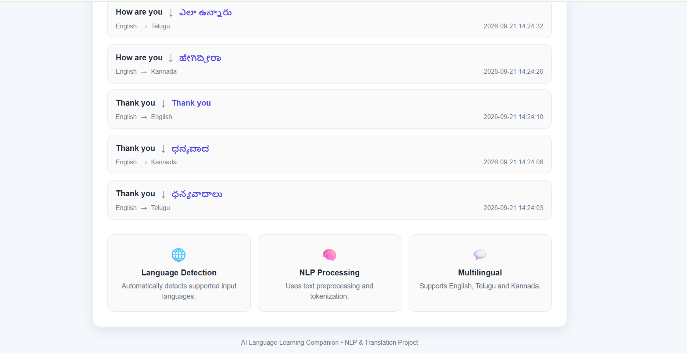

# AI Language Learning Companion

An AI-powered multilingual translation and language-learning web application that supports **English**, **Telugu**, and **Kannada**. It uses NLP techniques for language detection, text preprocessing, and translation, with a clean, responsive interface and translation history.

## 🚀 Live Demo

**Frontend:**
Coming soon (Render deployment)

**Local URL:**
http://127.0.0.1:5000

---

## 📌 Problem Statement

Language learners and multilingual users often struggle with:

* Translating between Indian languages and English
* Understanding regional scripts (Telugu / Kannada)
* Finding a simple, distraction-free translation tool
* Tracking previously translated phrases for practice
* Using heavy translation apps with ads and clutter
* Getting wrong-script output from generic translators

Most online translators are English-centric and don't handle Indian languages reliably.

---

## 💡 Solution

The application provides a clean, focused translation companion that:

1. **Detects** the input language automatically
2. **Preprocesses** the text using NLP techniques
3. **Translates** using a 3-tier pipeline (dictionary → Google → MyMemory)
4. **Validates** the output script (Telugu / Kannada / English)
5. **Saves** translations to history for practice and review

The app is designed for students, travelers, and language learners who want a lightweight, reliable tool.

---

## ✨ Key Features

### 🌐 Language Detection

* Automatic detection of English, Telugu, and Kannada
* Unicode-range detection for Telugu and Kannada scripts
* Statistical language detection for short English text
* Handles mixed and short inputs reliably

### 🧠 NLP Preprocessing & Tokenization

* Text cleaning and normalization
* Word-level tokenization using NLTK
* Token display in the UI for language-learning support
* Foundation for future word-by-word meaning features

### 🔄 Multilingual Translation

* English ↔ Telugu
* English ↔ Kannada
* Telugu ↔ Kannada
* Supports full sentences and common phrases

### 🛡️ Smart Translation Pipeline

* **Tier 1:** Local phrase dictionary for high-frequency expressions
* **Tier 2:** GoogleTranslator (primary translation engine)
* **Tier 3:** MyMemoryTranslator (fallback when Google rate-limits)
* **Validation:** Script checker rejects wrong-script output

### 📜 Translation History

* Every successful translation is saved
* Stored in SQLite
* Displays last 20 translations
* Includes source text, translated text, language pair, and timestamp

### 📋 Copy & Clear

* One-click copy to clipboard
* Quick form reset
* Better UX for repeated use

### 🎨 Responsive UI

* Works on desktop and mobile
* Clean card-based layout
* Light color palette
* Accessible and distraction-free

---

## 🛠️ Technology Stack

### Frontend

* HTML5
* CSS3
* JavaScript (Vanilla)
* Fetch API

### Backend

* Python 3.13
* Flask 3.1

### NLP

* NLTK
* langdetect
* Custom Unicode-based script detection

### Translation

* deep-translator
* GoogleTranslator
* MyMemoryTranslator
* Local phrase dictionary

### Database

* SQLite

### Deployment (planned)

* GitHub
* Render

---

## 🏗️ Project Architecture

```text
AI-Language-Learning-Companion/
│
├── app.py                       # Flask app + routes + translation pipeline
├── requirements.txt
├── README.md
├── .gitignore
│
├── nlp/
│   ├── preprocessing.py         # Tokenization & text cleaning
│   └── language_detector.py     # Language detection logic
│
├── templates/
│   └── index.html               # Main UI
│
├── static/
│   ├── style.css
│   └── script.js
│
├── database/
│   ├── init_db.py               # Creates SQLite database
│   └── history.db
│
└── screenshots/
```

---

## 🔄 Application Workflow

```text
User Opens App
    ↓
Enter Text (English / Telugu / Kannada)
    ↓
Select Target Language
    ↓
Click Translate
    ↓
Language Detection (Unicode + langdetect)
    ↓
NLP Preprocessing & Tokenization (NLTK)
    ↓
Translation Pipeline
    ↓
Local Dictionary → Google → MyMemory
    ↓
Script Validation
    ↓
Display Result + Tokens + Detected Language
    ↓
Save to SQLite History
    ↓
View in Translation History Panel
```

---

## 🔌 API Endpoints

| Method | Endpoint | Description |
|--------|----------|-------------|
| GET | `/` | Renders the main page |
| POST | `/translate` | Accepts `{ text, target_language }`, returns translation, tokens, and detected language |
| GET | `/history` | Returns the last 20 translations |

---## 📸 Screenshots

### 🏠 Main Interface & Dashboard



### 🌐 Translation Result



### 🔄 Translation Examples







### 📜 Translation History








---

## 🧪 Testing

The application was tested across the following workflows:

* Language detection for English, Telugu, and Kannada
* Short-word detection (e.g., `hello`, `hi`)
* Full-sentence detection (e.g., `I am learning Telugu language`)
* Translation for common phrases (dictionary path)
* Translation for arbitrary sentences (Google path)
* Fallback path when Google rate-limits (MyMemory)
* Script validation rejecting wrong-script output
* Copy-to-clipboard functionality
* Clear button resetting the form
* Translation history saving and loading
* Responsive UI on mobile and desktop
* Error handling for unsupported languages
* Error handling for empty input

---

## 💻 Run Locally

### 1. Clone the repository

```bash
git clone <your-repo-url>
cd AI-Language-Learning-Companion
```

### 2. Create and activate a virtual environment

**Windows (PowerShell):**

```powershell
python -m venv venv
.\venv\Scripts\Activate.ps1
```

**macOS / Linux:**

```bash
python3 -m venv venv
source venv/bin/activate
```

### 3. Install dependencies

```bash
pip install -r requirements.txt
```

### 4. Initialize the database

```bash
python database/init_db.py
```

### 5. Run the Flask app

```bash
python app.py
```

### 6. Open in browser

```text
http://127.0.0.1:5000
```

---

## ⚙️ Environment & Configuration

The application does not require API keys for translation (uses public translation endpoints via `deep-translator`).

Configuration:

* **Database path:** `database/history.db` (auto-resolved using absolute path)
* **Flask debug mode:** enabled in development
* **Supported languages:** English (`en`), Telugu (`te`), Kannada (`kn`)

---

## 🌐 Deployment

The application can be deployed to Render or any Python web host.

### Backend (Flask)

```text
Flask App
   ↓
Gunicorn (WSGI Server)
   ↓
Render Web Service
   ↓
SQLite Database
```

### Deployment Notes

* `requirements.txt` contains all dependencies
* `database/init_db.py` should be run once after deployment
* For production, use Gunicorn:
  ```bash
  gunicorn app:app
  ```

---

## 🎯 Project Objective

The main objective of this project is to provide a **simple, reliable, and learner-focused** translation tool for English, Telugu, and Kannada.

The system focuses on:

* Practical usability over complexity
* Reliability through multi-tier fallback
* Accuracy through script validation
* Learning support through NLP tokenization
* Clean, distraction-free user experience

---

## 📚 What I Learned

Through this project, I worked with:

* Flask web application development
* REST API design (POST /translate, GET /history)
* NLP preprocessing and tokenization with NLTK
* Language detection using Unicode ranges and langdetect
* Multi-tier fallback architecture for reliability
* Unicode script validation for Indian languages
* SQLite database integration
* Frontend development with HTML, CSS, and JavaScript
* Asynchronous API calls using Fetch
* Responsive UI design
* Debugging translation API rate-limits
* Error handling and graceful degradation
* Building a resume-ready full-stack NLP project

---

## 🔮 Future Improvements

Potential future enhancements include:

* Translation caching to reduce API calls
* Word-by-word meaning breakdown (Learn Mode)
* Audio pronunciation (text-to-speech)
* Flashcard and quiz features
* Support for more Indian languages (Tamil, Malayalam, Hindi)
* User accounts and personal phrasebooks
* Offline translation with local models (IndicTrans)
* Deployment with production-grade WSGI server
* Progressive Web App (PWA) support

---

## 👩‍💻 Developer

**Pavithra**

AI & Data Science Graduate | Full-Stack Developer

This project was developed as a resume-ready AI/NLP application focused on multilingual translation, natural language processing, and clean user experience.

---

## 📄 License

This project is developed for educational and portfolio purposes.